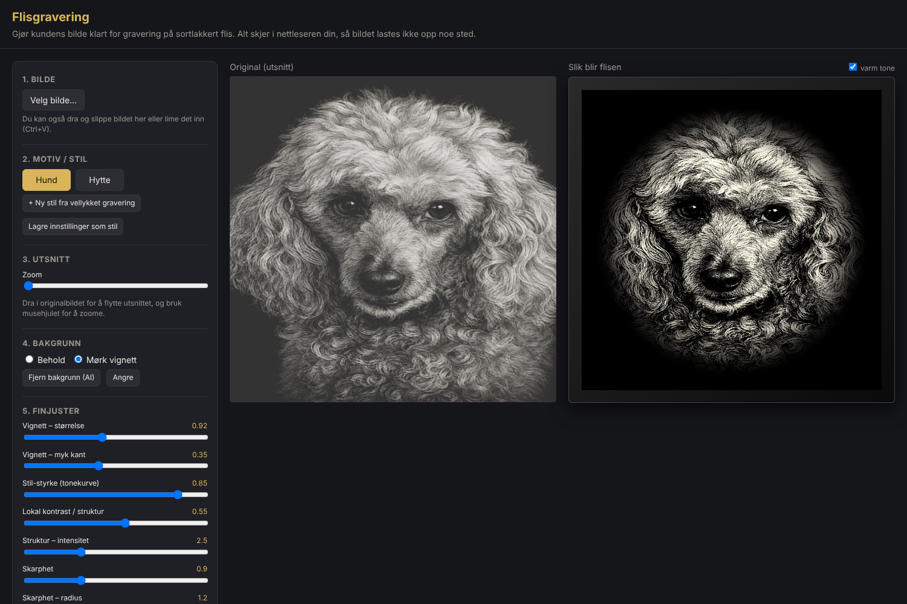
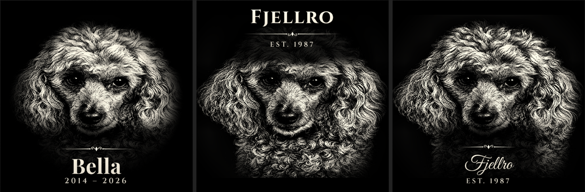

# Flisgravering – bildeforberedelse

En nettside som gjør et kundebilde klart for laser­gravering på hvite flis (20×20 cm) som er lakkert sorte.
Målet er at nye motiver skal få samme kontrast, lysstyrke og tonefordeling som de graveringene som ble best.

Alt kjører lokalt i nettleseren, så bildene sendes ikke til noen server.

## Bruk
1. Åpne `index.html` i nettleseren. Du kan også legge den ut med GitHub Pages: Settings → Pages → Branch.
2. Last opp bildet. Du kan dra det inn, velge fil eller lime inn med Ctrl+V.
3. Velg stil: **Hund** eller **Hytte**.
4. Juster utsnittet. Som standard er hele bildet med, også brede bilder som biler og panorama. Da blir det sort over og under, med myk overgang. Trykk **Fyll hele ruten** hvis du heller vil beskjære. Dra i bildet og zoom med musehjulet. Under zoomen står det om noe blir kuttet bort.
5. Velg bakgrunn: *Mørk vignett*, eller *Fjern bakgrunn (AI)*, som krever internett.
6. Finjuster med glidebryterne om nødvendig.
7. Last ned PNG. Filen får riktig DPI for 20 cm. Huk av for *Inverter* hvis laserprogrammet brenner der bildet er sort, slik LightBurn gjør som standard.

## Navn på flisen

Skriv navnet på hunden eller hytta i feltet **Navn**. Du kan også legge til en undertekst, for eksempel «2014 – 2026» eller «Est. 1987».
* **Plassering:** over eller under motivet. Hund har navnet under som standard, og Hytte har det over.
* **Skrift:** Klassisk (Playfair), Romersk (Cinzel), Håndskrift (Great Vibes) eller Georgia. De tre første lastes fra Google Fonts. Uten nett brukes Georgia.
* **Ornament:** en pyntelinje med krusedull, som på «Åge 40 år»-flisen.
* **Mørk sone bak teksten:** Bildet tones ned mot sort bak teksten, slik at bokstavene står rent og hvitt.
* Zoom under 1 krymper motivet, slik at det blir plass til teksten.

## Slik fungerer det
1. **Gråtoner og beskjæring** til et kvadrat.
2. **Lokal kontrast (CLAHE)** henter fram struktur i pels, treverk og vann, og gir det «graverte» uttrykket.
3. **Histogram-matching**: Motivets toner tvinges mot en tonekurve som er målt fra de vellykkede graveringene. Målingen gjelder bare motivet, ikke den sorte bakgrunnen.
4. **Skarphet** (uskarp maske), deretter **nivåer** (sortpunkt og hvitpunkt, gamma, kontrast).
5. **Vignett eller maske**: Bakgrunnen går mykt over i sort, slik at lakken blir stående der.

## Nettbutikk (Shopify)
En enkel kundeversjon ligger i `shop/`, og de ferdige temafilene i `shopify/`. Se **[SHOPIFY.md](SHOPIFY.md)** for hvordan du installerer den, og hvordan du åpner bestillinger i dette verktøyet.

## Mapper
* `index.html`, `js/app.js`: graveringsverktøyet ditt (admin)
* `js/presets.js`, `js/processing.js`, `js/crop.js`, `js/text.js`: felles kjerne
* `shop/`: kunde-editor for nettbutikken
* `shopify/`: ferdige filer til Shopify-temaet, bygget med `node tools/build-shopify.mjs`

## Egne stiler
* **«+ Ny stil fra vellykket gravering»**: Last opp et bilde som ble bra. Appen måler tonekurven i det og lagrer den som en ny stil, for eksempel «Katt» eller «Portrett».
* **«Lagre innstillinger som stil»**: Lagrer glidebryterne du har stilt inn.

Egne stiler lagres i nettleseren (localStorage). Høyreklikk på en egen stil for å slette den.
